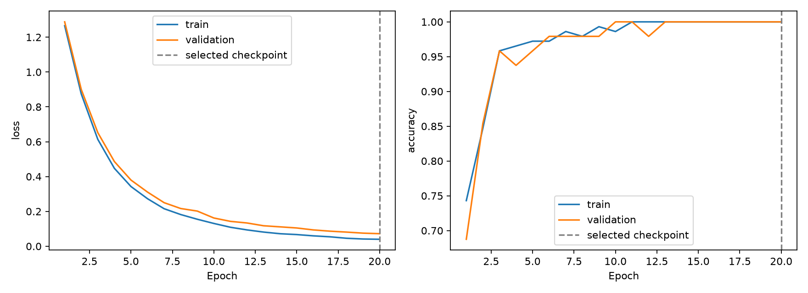
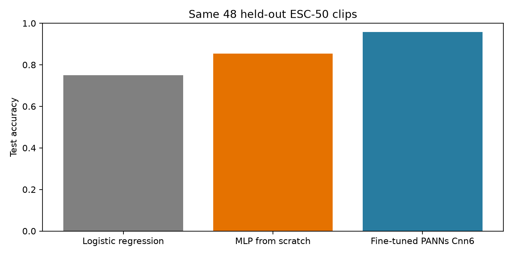

# Sound Detective — HW2: Make Your Application Learn

A React + FastAPI application that classifies environmental audio with a **PyTorch MLP trained from scratch and a fine-tuned AudioSet-pretrained PANNs Cnn6**. Listen, inspect waveforms, annotate intervals, and ask the model to identify six sounds. The original HW1 viewer and blind-listening challenge are preserved.

## Project organization

```text
sound-detective/
├── frontend/                 # React + Vite application
│   ├── src/
│   ├── public/               # Icons and companion artwork
│   └── package.json
├── backend/
│   ├── app.py                # FastAPI predictions, metrics and sample audio
│   └── model/                # Trained MLP, fine-tuned PANNs and baseline weights
├── data/
│   ├── samples/              # 18 public demo WAVs, metadata and attribution
│   ├── raw/                  # Downloaded training dataset (Git-ignored)
│   └── cache/                # Features/source checkpoint (Git-ignored)
├── training/
│   ├── train.py              # MLP training and baseline evaluation
│   ├── model.py              # Small MLP definition
│   ├── finetune.py           # PANNs partial fine-tuning
│   ├── pretrained.py         # Adapted PANNs architecture
│   ├── features.py
│   ├── prepare.py
│   ├── notebooks/            # Two executed Jupyter notebooks
│   └── results/              # Saved metrics, provenance and plots
├── tests/                    # Python pipeline/API tests
├── scripts/                  # Sample restoration and notebook generation
├── docs/                     # Demo guide and model explanation
├── third_party/              # PANNs licenses and attribution
├── requirements.txt
├── requirements-notebook.txt
└── README.md
```

All commands below run from the repository root. React dependencies and build output live inside `frontend/`. FastAPI serves `/audio` directly from `data/samples/audio`; Vite proxies audio and API requests to it, so both servers are required. The sample WAVs are stored only once.

## Run the complete application

Requirements: Python 3.11, Node.js >=22.12, npm. Both trained checkpoints and 18 demonstration WAVs are included; downloading the training dataset is unnecessary for inference. Internet is needed to install dependencies.

```sh
python3 -m venv .venv
source .venv/bin/activate
pip install -r requirements.txt
npm --prefix frontend ci
```

Start the backend in terminal 1 (from the repository root):

```sh
source .venv/bin/activate
python -m uvicorn backend.app:app --host 127.0.0.1 --port 8000
```

Start the frontend in terminal 2:

```sh
npm --prefix frontend run dev
```

Open http://127.0.0.1:5173. Vite forwards `/api` to the local backend. Both processes must be running. For a production-build preview use `npm --prefix frontend run build && npm --prefix frontend run preview` with the backend still running. A static-only deployment cannot run the Python model.

## HW2 features

- Real inference from audio samples, not filenames or stored dataset answers.
- Switch between the MLP and the partially fine-tuned PANNs Cnn6 in the web interface.
- Two executed Jupyter notebooks expose the actual training loops and saved outputs.
- Predict the current library recording, one of six held-out examples, or an uploaded WAV.
- Display all six softmax scores, the predicted label, and test-example correctness.
- Preserve blind-listening gameplay: predictions unlock after the user's guess.
- Display saved training/validation loss and accuracy curves, train/validation/test metrics, a shallow baseline comparison, and a test confusion matrix.
- Actionable connection/input errors; switching inputs cancels stale prediction results.
- Annotation: implemented in HW1, using localStorage and JSON export.
- Backend: FastAPI inference service implemented. Database: not implemented.
- Optional interactive training: not implemented. The experiment dashboard displays a saved run; it is not a live training monitor.

## Dataset and split

Six ESC-50 categories: dog, rain, sea waves, crackling fire, clock tick, sneezing. There are **240 recordings**, 40 per class. Each original WAV is five seconds, mono, 44.1 kHz. Download source is pinned to revision `33c8ce9eb2cf0b1c2f8bcf322eb349b6be34dbb6`.

| Split | Official folds | Recordings | Purpose |
| --- | --- | ---: | --- |
| Train | 1–3 | 144 | Fit feature scaling and model weights |
| Validation | 4 | 48 | Select hyperparameters and checkpoint |
| Test | 5 | 48 | Final evaluation only |

Official folds keep excerpts of the same source recording together. The training script asserts disjoint source IDs. No test data is used for normalization, early stopping, or model selection. The original 12 library clips belong to **training fold 1**; they are explicitly labeled as training examples in the prediction panel. Six additional fold-5 clips are bundled, one per class selected by the first filename in alphabetical order, independently of prediction quality. Reported test metrics use all 48 test clips.

The per-recording source metadata and SHA-256 hashes are in `training/results/data-provenance.json`. Dataset attribution/license remains in `data/samples/ESC50-LICENSE.txt`, including the added test recordings.

## Jupyter notebooks (recommended training workflow)

Install notebook dependencies into the same virtual environment:

```sh
source .venv/bin/activate
pip install -r requirements-notebook.txt
jupyter lab
```

Open and run in order:

1. [01 — MLP from scratch](training/notebooks/01_mlp_from_scratch.ipynb): features, model definition, explicit forward/backward/SGD loop, validation selection, logistic-regression baseline, final evaluation and export.
2. [02 — Pretrained audio fine-tuning](training/notebooks/02_pretrained_audio_finetuning.ipynb): pretrained architecture and verified download, layer freezing, explicit fine-tuning loop, checkpoint selection, test evaluation and three-model comparison.

Both notebooks were executed end to end, and their outputs are saved. They contain the training code rather than just calling an external training script. Use **Restart Kernel and Run All** to reproduce. Run 01 before 02. Outputs overwrite the corresponding model artifacts; restart the backend afterwards. GPU results may vary slightly across platforms. `scripts/build-notebooks.py` rebuilds notebook sources from the matching CLI implementation and clears outputs, so do not run it merely to view notebooks.

## MLP model and training

Pipeline: WAV → mono → resample to 22,050 Hz → pad/trim to 5 seconds → 64 log-mel bands and 20 MFCCs → temporal mean and standard deviation → **168 features** → training-only standardization → **Linear(168,64), ReLU, Dropout(0.5), Linear(64,6)**.

The network contains 11,206 trainable parameters and one hidden layer. Cross-entropy consumes logits; softmax is applied only to display inference scores. `training/train.py` explicitly performs forward propagation, loss calculation, `loss.backward()`, and `optimizer.step()`.

- Optimizer: SGD, learning rate 0.03, momentum 0.9, weight decay 0.001, batch size 24.
- Seed: 7400, deterministic CPU training.
- Declared validation search: hidden size {32,64,128}, learning rate {0.01,0.03}, dropout {0.2,0.5}; 12 runs total.
- Maximum 300 epochs, early stopping after 45 epochs without validation-loss improvement.
- Select by minimum validation cross-entropy. Selected checkpoint: **epoch 8**; the displayed run continues to epoch 53 before stopping.
- Baseline: logistic regression on exactly the same features and split. C selected from {0.01,0.1,1,10,100} by validation accuracy, ties favor the first/smaller C; selected C=1.

| Model | Test accuracy | Test error | Macro F1 |
| --- | ---: | ---: | ---: |
| MLP | **85.42% (41/48)** | **14.58%** | **0.8583** |
| Logistic regression | 75.00% (36/48) | 25.00% | 0.7509 |
| Fine-tuned PANNs Cnn6 | **95.83% (46/48)** | **4.17%** | **0.9566** |

The MLP improves accuracy by 10.42 percentage points on this split. It makes seven mistakes, including confusion between dog barks and clock ticks. Short transient sounds may have similar aggregated spectral features. Temporal averaging discards event order, and 144 training recordings are a small sample. These are six-class, single-split results, not a claim about full ESC-50 or arbitrary sounds. Softmax scores are not calibrated confidence, and unsupported sounds will still be assigned one of the six labels.


## Pretrained audio model: PANNs Cnn6

PANNs Cnn6 was pretrained for 527 AudioSet classes. We use its original [official AudioSet checkpoint](https://zenodo.org/records/3987831), not weights previously fine-tuned on ESC-50. The source checkpoint is verified against its published MD5 before loading. Source code and weight attribution are in [third_party/PANNs-NOTICE.md](third_party/PANNs-NOTICE.md).

Input: mono audio resampled to 32 kHz, padded/trimmed to 5 seconds → power spectrogram (FFT 1024, hop 320) → 64 log-mel bands (50–14,000 Hz) → four pretrained 5×5 convolution blocks → frequency mean and temporal max+mean pooling → pretrained 512-unit dense layer → new six-class head.

**Actual partial fine-tuning:** blocks 1–3 and all batch-normalization running statistics stay frozen; block 4, the original fc1, and the new six-class output layer are optimized. There are **3,543,558 trainable parameters**. The saved report records nonzero changes in both pretrained convolution and dense weights, so this is more than a frozen embedding/linear probe. Frozen prefixes are cached to save computation. Serving runs the full model from the waveform.

One fixed schedule, chosen before inspecting this model's test result: AdamW; learning rate 1e-4 for pretrained layers and 1e-3 for the new head; weight decay 0.01; batch size 8; maximum 20 epochs; validation-loss early stopping patience 5. Selected checkpoint: epoch 20. Actual run used Apple MPS. Validation accuracy was 48/48; test accuracy was 46/48. The two test mistakes were crackling-fire recordings predicted as rain or sea waves.

The three models share the same 144/48/48 split. PANNs uses extra pretraining data and a different architecture/input representation, so the comparison does not isolate the causal contribution of pretraining. The same test fold was already reported for the MLP; this is a fixed homework comparison, not a new blind benchmark. No parameters were changed based on the pretrained model's test score. Upstream pretraining overlap has not been independently audited.




### Reproduce training with the CLI

```sh
source .venv/bin/activate
python -m training.prepare
python -m training.train
python -m training.finetune
```

The download is approximately 106 MB. `data/raw/` (downloaded training WAVs/metadata) and `data/cache/` (features and source pretrained weights) are ignored by Git. Only the 18 public demonstration clips in `data/samples/` are committed. Training writes model checkpoints to `backend/model/` and metrics/plots to `training/results/`; reload the backend after retraining because it caches the checkpoint. The pinned inference/training environment is in `requirements.txt`, with notebook tools in `requirements-notebook.txt`; minor numerical differences can occur on other platforms. Test data is evaluated after the declared validation search; do not tune the model based on test results.

### Validation

```sh
python -m pytest -q
npm --prefix frontend test
npm --prefix frontend run build
```

Backend tests check real inference against saved test probabilities, filename independence, invalid/silent/oversized uploads, source separation, and learning via backpropagation. Frontend tests cover the original viewer plus inference, blind-mode gating, stale requests, and backend errors. A browser walkthrough additionally verifies real HTTP inference, WAV upload, report rendering, and mobile layout.

## Files

| Path | Purpose |
| --- | --- |
| `training/prepare.py` | Pinned six-class dataset download and provenance |
| `training/features.py` | Shared training/inference preprocessing |
| `training/model.py` | Small MLP architecture |
| `training/train.py` | MLP training, validation selection, baseline, final evaluation |
| `training/pretrained.py` | Adapted PANNs architecture and verified pretrained loading |
| `training/finetune.py` | Partial fine-tuning, selection, evaluation, weight-change evidence |
| `training/notebooks/` | Two executed notebooks with explicit training cells |
| `backend/model/sound-panns.pt` | Complete fine-tuned PANNs checkpoint for offline inference |
| `backend/app.py` | FastAPI prediction and metrics endpoints |
| `backend/model/sound-mlp.pt` | Trained weights and training-only scaling parameters |
| `training/results/metrics.json` | Full curves, trial selection, metrics, and test predictions |
| `frontend/src/components/PredictionPanel.jsx` | Interactive predictions and upload |
| `frontend/src/components/TrainingReport.jsx` | Saved experiment dashboard |
| `docs/DEMO.md` | Three-minute demonstration plan |
| `docs/UNDERSTAND_THE_MODEL.md` | Explanation guide for the student |

## AI assistance and references

OpenAI Codex was used to implement the HW2 pipeline, backend, interface, tests, documentation, and demonstration materials. PyTorch autograd and standard librosa/scikit-learn implementations are used; the small MLP is defined in this repository. The Cnn6 implementation is adapted from PANNs (MIT code); its official AudioSet weights are CC BY 4.0. See the third-party notice for modifications and attribution. The student must review and understand this work and be able to explain it independently.

- [PANNs paper and audio transfer learning](https://arxiv.org/abs/1912.10211)
- [ESC-50 dataset and official fold protocol](https://github.com/karolpiczak/ESC-50)
- K. J. Piczak, *ESC: Dataset for Environmental Sound Classification*, ACM Multimedia, 2015. [DOI](https://doi.org/10.1145/2733373.2806390).
- [PyTorch neural-network training tutorial](https://pytorch.org/tutorials/beginner/basics/optimization_tutorial.html)
- [librosa MFCC reference](https://librosa.org/doc/latest/generated/librosa.feature.mfcc.html)
- [scikit-learn LogisticRegression](https://scikit-learn.org/stable/modules/generated/sklearn.linear_model.LogisticRegression.html)

## Pixel-art credits

Pikachu, Eevee, and Jigglypuff are displayed using unmodified Generation V sprites from [PokeAPI/sprites](https://github.com/PokeAPI/sprites). The original PNG files, upstream repository license, and per-file source URLs are bundled in [`frontend/public/pokemon/`](frontend/public/pokemon/CREDITS.txt). Pokémon artwork and characters remain the property of their respective owners. This is an unaffiliated non-commercial student project. Companion images are decorative and do not classify or alter the audio data.

## Dataset license

ESC-50 audio is CC BY-NC, with CC BY terms for ESC-10 subset recordings. Preserve the upstream license and individual source attributions in `data/samples/ESC50-LICENSE.txt`. Original WAVs are unchanged. This is a non-commercial student project.
