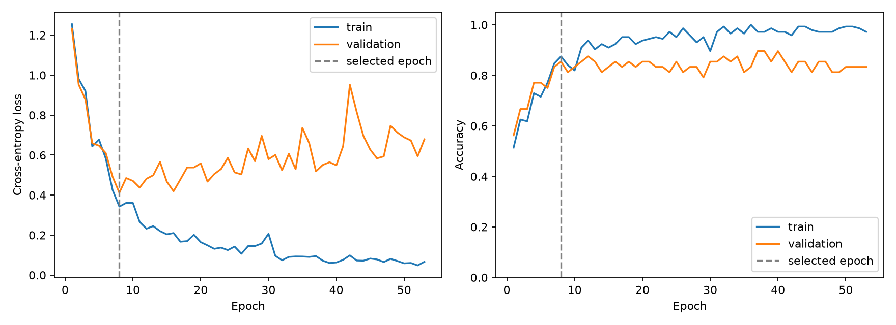

# Sound Detective — HW2: Make Your Application Learn

A React + FastAPI application that classifies environmental audio with a **trained PyTorch MLP**. Listen, inspect waveforms, annotate intervals, and ask the model to identify six sounds. The original HW1 viewer and blind-listening challenge are preserved.

## Run the complete application

Requirements: Python 3.11, Node.js >=22.12, npm. The trained weights and 18 demonstration WAVs are included; downloading the training dataset is unnecessary for inference. Internet is needed to install dependencies.

```sh
python3 -m venv .venv
source .venv/bin/activate
pip install -r requirements.txt
npm ci
```

Start the backend in terminal 1 (from the repository root):

```sh
source .venv/bin/activate
python -m uvicorn backend.app:app --host 127.0.0.1 --port 8000
```

Start the frontend in terminal 2:

```sh
npm run dev
```

Open http://127.0.0.1:5173. Vite forwards `/api` to the local backend. Both processes must be running. For a production-build preview use `npm run build && npm run preview` with the backend still running. A static-only deployment cannot run the Python model.

## HW2 features

- Real inference from audio samples, not filenames or stored dataset answers.
- Predict the current library recording, one of six held-out examples, or an uploaded WAV.
- Display all six softmax scores, the predicted label, and test-example correctness.
- Preserve blind-listening gameplay: predictions unlock after the user's guess.
- Display saved training/validation loss and accuracy curves, train/validation/test metrics, a shallow baseline comparison, and a test confusion matrix.
- Actionable connection/input errors; switching inputs cancels stale prediction results.
- Annotation: implemented in HW1, using localStorage and JSON export.
- Backend: FastAPI inference service implemented. Database: not implemented.
- Optional interactive training: not implemented. The experiment dashboard displays a saved run; it is not a live training monitor.

## Dataset and split

Six ESC-50 categories: dog, rain, sea waves, crackling fire, clock tick, sneezing. There are **240 recordings**, 40 per class. Each original WAV is five seconds, mono, 44.1 kHz. Download source is pinned to revision `33c8ce9eb2cf0b1c2f8bcf322eb349b6be34dbb6`.

| Split | Official folds | Recordings | Purpose |
| --- | --- | ---: | --- |
| Train | 1–3 | 144 | Fit feature scaling and model weights |
| Validation | 4 | 48 | Select hyperparameters and checkpoint |
| Test | 5 | 48 | Final evaluation only |

Official folds keep excerpts of the same source recording together. The training script asserts disjoint source IDs. No test data is used for normalization, early stopping, or model selection. The original 12 library clips belong to **training fold 1**; they are explicitly labeled as training examples in the prediction panel. Six additional fold-5 clips are bundled, one per class selected by the first filename in alphabetical order, independently of prediction quality. Reported test metrics use all 48 test clips.

The per-recording source metadata and SHA-256 hashes are in `artifacts/data-provenance.json`. Dataset attribution/license remains in `public/ESC50-LICENSE.txt`, including the added test recordings.

## Model and training

Pipeline: WAV → mono → resample to 22,050 Hz → pad/trim to 5 seconds → 64 log-mel bands and 20 MFCCs → temporal mean and standard deviation → **168 features** → training-only standardization → **Linear(168,64), ReLU, Dropout(0.5), Linear(64,6)**.

The network contains 11,206 trainable parameters and one hidden layer. Cross-entropy consumes logits; softmax is applied only to display inference scores. `training/train.py` explicitly performs forward propagation, loss calculation, `loss.backward()`, and `optimizer.step()`.

- Optimizer: SGD, learning rate 0.03, momentum 0.9, weight decay 0.001, batch size 24.
- Seed: 7400, deterministic CPU training.
- Declared validation search: hidden size {32,64,128}, learning rate {0.01,0.03}, dropout {0.2,0.5}; 12 runs total.
- Maximum 300 epochs, early stopping after 45 epochs without validation-loss improvement.
- Select by minimum validation cross-entropy. Selected checkpoint: **epoch 8**; the displayed run continues to epoch 53 before stopping.
- Baseline: logistic regression on exactly the same features and split. C selected from {0.01,0.1,1,10,100} by validation accuracy, ties favor the first/smaller C; selected C=1.

| Model | Test accuracy | Test error | Macro F1 |
| --- | ---: | ---: | ---: |
| MLP | **85.42% (41/48)** | **14.58%** | **0.8583** |
| Logistic regression | 75.00% (36/48) | 25.00% | 0.7509 |

The MLP improves accuracy by 10.42 percentage points on this split. It makes seven mistakes, including confusion between dog barks and clock ticks. Short transient sounds may have similar aggregated spectral features. Temporal averaging discards event order, and 144 training recordings are a small sample. These are six-class, single-split results, not a claim about full ESC-50 or arbitrary sounds. Softmax scores are not calibrated confidence, and unsupported sounds will still be assigned one of the six labels.



### Reproduce training

```sh
source .venv/bin/activate
python -m training.prepare
python -m training.train
```

The download is approximately 106 MB. `data/` is ignored by Git. Training replaces `artifacts/sound-mlp.pt`, `baseline.npz`, `metrics.json`, and `learning-curves.png`; reload the backend after retraining because it caches the checkpoint. The complete pinned Python environment is in `requirements.txt`; minor numerical differences can occur on other platforms. Test data is evaluated after the declared validation search; do not tune the model based on test results.

### Validation

```sh
python -m pytest -q
npm test
npm run build
```

Backend tests check real inference against saved test probabilities, filename independence, invalid/silent/oversized uploads, source separation, and learning via backpropagation. Frontend tests cover the original viewer plus inference, blind-mode gating, stale requests, and backend errors. A browser walkthrough additionally verifies real HTTP inference, WAV upload, report rendering, and mobile layout.

## Files

| Path | Purpose |
| --- | --- |
| `training/prepare.py` | Pinned six-class dataset download and provenance |
| `training/features.py` | Shared training/inference preprocessing |
| `training/model.py` | Small MLP architecture |
| `training/train.py` | Training, validation selection, baseline, final evaluation |
| `backend/app.py` | FastAPI prediction and metrics endpoints |
| `artifacts/sound-mlp.pt` | Trained weights and training-only scaling parameters |
| `artifacts/metrics.json` | Full curves, trial selection, metrics, and test predictions |
| `src/components/PredictionPanel.jsx` | Interactive predictions and upload |
| `src/components/TrainingReport.jsx` | Saved experiment dashboard |
| `docs/DEMO.md` | Three-minute demonstration plan |
| `docs/UNDERSTAND_THE_MODEL.md` | Explanation guide for the student |

## AI assistance and references

OpenAI Codex was used to implement the HW2 pipeline, backend, interface, tests, documentation, and demonstration materials. PyTorch autograd and standard librosa/scikit-learn implementations are used; the small MLP is defined in this repository. The student must review and understand this work and be able to explain it independently.

- [ESC-50 dataset and official fold protocol](https://github.com/karolpiczak/ESC-50)
- K. J. Piczak, *ESC: Dataset for Environmental Sound Classification*, ACM Multimedia, 2015. [DOI](https://doi.org/10.1145/2733373.2806390).
- [PyTorch neural-network training tutorial](https://pytorch.org/tutorials/beginner/basics/optimization_tutorial.html)
- [librosa MFCC reference](https://librosa.org/doc/latest/generated/librosa.feature.mfcc.html)
- [scikit-learn LogisticRegression](https://scikit-learn.org/stable/modules/generated/sklearn.linear_model.LogisticRegression.html)

## Pixel-art credits

Pikachu, Eevee, and Jigglypuff are displayed using unmodified Generation V sprites from [PokeAPI/sprites](https://github.com/PokeAPI/sprites). The original PNG files, upstream repository license, and per-file source URLs are bundled in [`public/pokemon/`](public/pokemon/CREDITS.txt). Pokémon artwork and characters remain the property of their respective owners. This is an unaffiliated non-commercial student project. Companion images are decorative and do not classify or alter the audio data.

## Dataset license

ESC-50 audio is CC BY-NC, with CC BY terms for ESC-10 subset recordings. Preserve the upstream license and individual source attributions in `public/ESC50-LICENSE.txt`. Original WAVs are unchanged. This is a non-commercial student project.
