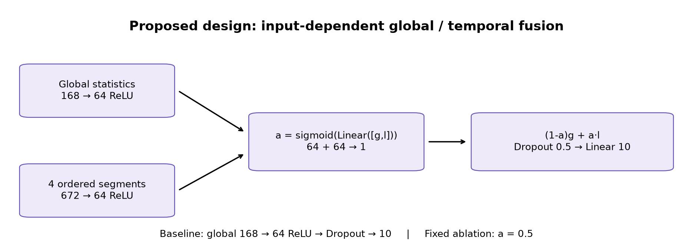
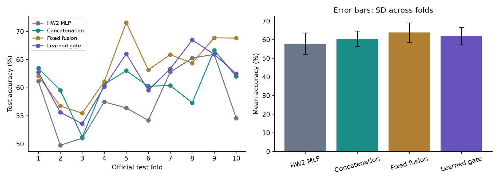
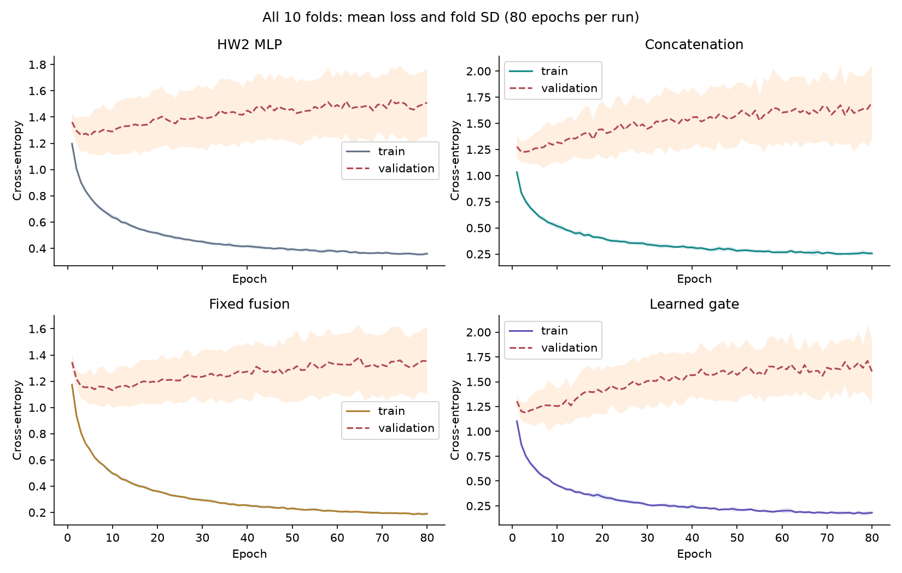
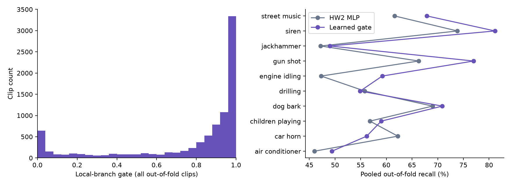

# HW3: Does temporal information need a learned gate?

This experiment extends the HW2 environmental-sound MLP to **UrbanSound8K (8,732 clips, 10 classes)**, then tests global/temporal feature fusion. HW2's six-class app, weights, and results remain unchanged. The HW3 models predict a different label set and are not loaded into the HW2 web app.

## Hypothesis, fixed before results

The HW2 representation averages over time, discarding temporal structure. Four ordered segments may preserve short events and changes within a recording. An input-dependent gate may suppress unreliable segment features while retaining useful local evidence. Expected failure modes include overfitting, sigmoid saturation, sensitivity to segment boundaries, and padded short clips. Gates are routing coefficients, not causal explanations or calibrated confidence.

The design adapts established multi-branch/gating principles to this task; it is not a claim to invent gating. AI assisted with brainstorming, implementation, and analysis. The user selected the temporal-feature direction and requested a larger dataset. The student should review the results and make their own interpretation before submission.

## Data and relationship to HW2

- [Official UrbanSound8K documentation](https://urbansounddataset.weebly.com/urbansound8k.html)
- [Original archive, DOI 10.5281/zenodo.1203745](https://zenodo.org/records/1203745)
- J. Salamon, C. Jacoby and J. P. Bello, *A Dataset and Taxonomy for Urban Sound Research*, ACM Multimedia, 2014.
- 8,732 original clips (up to four seconds), compared with 240 in HW2: approximately 36.4 times as many. Ten classes instead of six. These are related environmental-sound tasks, not identical benchmarks. Do not compare HW3 percentages directly with HW2's 85.4%.
- The original archive is approximately 6 GB, and extracted data requires additional disk space. Archive MD5 is checked against `9aa69802bbf37fb986f71ec1483a196e`. Per-clip SHA-256, labels, source IDs and folds are recorded in `results/provenance.json`.
- Data and feature caches live in Git-ignored `data/raw/urbansound8k/` and `data/cache/`. The archive README specifies CC BY-NC 3.0 (noncommercial attribution); original license and Freesound attribution remain with the downloaded archive; no audio is republished by this HW3 experiment.

The baseline transfers the HW2 design, **168 → 64 ReLU → Dropout(0.5) → 10**, and retrains it on the new data. The ten-class head replaces the six-class head; pretrained HW2 weights are not reused. Like HW2, preprocessing is mono, 22,050 Hz, five seconds with zero padding, FFT 1024/hop 256, 64 log-Mel bands and 20 MFCCs, followed by temporal means and standard deviations. All official short clips are retained, including those below the web uploader's 0.25-second minimum. Feature standardization is fitted only on each training partition.

## Controlled designs

| ID | Design | Question |
|---|---|---|
| `baseline` | Global 168 → 64 → 10 | How does the HW2 design transfer? |
| `concat` | Concatenate global 168 + four ordered segments 672 → 64 → 10 | Are extra features sufficient? |
| `fixed` | Global and local branches each produce 64 units; average them → 10 | Does two-branch processing help without a learned gate? |
| `gated` | Same branches; scalar `a = sigmoid(W[g;l]+b)`; fuse `(1-a)g + a*l` → 10 | Does input-dependent routing help beyond fixed fusion? |

Each segment contains means/stds from the same full-clip spectrogram, in chronological order. Four equal groups of spectrogram frames yield 672 local features. The gate starts at 0.5. Fixed and gated variants use exactly identical initial global/local/output weights, batch order, and dropout random stream. Their difference is the 129 trainable gate parameters. The baseline has fewer parameters; compare `gated` against `fixed` to assess the gate without the large capacity change.

## Protocol

`config.json` was committed before training or inspecting test results. No test-driven tuning or discarded runs.

- Ten outer evaluations, holding out each official fold once. No random clip reshuffling.
- Test fold `k`, validation fold `k % 10 + 1`, train on the other eight folds. An audit found five source IDs spanning multiple official folds (152 clips). Keep the original test fold; purge its sources from validation, then purge test and retained validation sources from training. Assert disjoint source IDs after this purge. All 8,732 clips still receive an out-of-fold test prediction. See `results/source-audit.json` and per-run counts.
- This uses all ten official test folds, but holds one additional fold out for validation rather than training on all nine non-test folds. It is a controlled homework experiment, not a directly comparable reproduction of published nine-fold training scores.
- Each of four variants trains for 80 epochs: 40 runs total, with identical examples, optimizer, epochs and batch size. The minimum-validation-cross-entropy checkpoint is restored before evaluation. The complete training budget is used even if validation loss rises.
- SGD, LR 0.03, momentum 0.9, weight decay 0.001, batch size 128, hidden width 64, dropout 0.5, CPU deterministic operations, two PyTorch threads.
- Seed `7400 + test_fold`, paired across variants. One seed per fold: fold variability is not a measure of initialization variability.
- Report accuracy, macro F1, loss, train/validation curves, fold SD, class recall, parameter counts, runtime and gates. Fold SD is descriptive, not a confidence interval; folds share training data.
- An additional diagnostic reverses the order of local segments at test time, retaining original positional scaling. This is a distribution shift, not definitive proof that chronological order is used; padding/position scaling can contribute. It does not affect checkpoint selection.

## Run

From the repository root, using the existing Python 3.11 environment:

```bash
python -m pip install -r requirements.txt
python -m training.hw3.prepare
python -m training.hw3.train
python -m training.hw3.analyze
python -m pytest tests/test_hw3.py -q
```

Download and extraction run once. Preparation verifies the archive and caches all features. Training saves each finished run independently and resumes completed runs only when their config hash matches. To rerun from scratch, move the prior `training/hw3/results/*-fold*.json` files and checkpoints into a local backup first. Do not mix new settings with old results. The executed notebook in this folder displays the model, training implementation and analysis.

`results/` contains all epoch histories, out-of-fold predictions, confusion matrices, and plots. `checkpoints/` contains selected state dictionaries and the corresponding training-only feature scaling for all runs. The separate report distinguishes the original hypothesis from observed results.

The recorded execution used four concurrent fold workers, each with two PyTorch threads. Wall times include resource contention and are descriptive, not isolated speed benchmarks. `results/split-counts.json` records source-purge exclusions for every fold.

## Measured results and interpretation

| Model | Mean test accuracy ± fold SD | Mean macro F1 | Parameters |
|---|---:|---:|---:|
| HW2 MLP baseline | 57.86% ± 5.71 | 0.5895 | 11,466 |
| Concatenation | 60.46% ± 4.11 | 0.6101 | 54,474 |
| Fixed fusion | **63.81% ± 5.23** | **0.6511** | 54,538 |
| Learned gate (proposed) | 61.81% ± 4.67 | 0.6249 | 54,667 |

The proposed gate improves over the retrained HW2 baseline by 3.95 percentage points (higher in nine folds, tied in one), but is **2.01 points below fixed fusion** and wins only two of ten folds against it. It beats concatenation by 1.35 points on average, but only five of ten folds. Thus the original claim that an adaptive gate should outperform fixed routing is not supported in this experiment. Fixed two-branch processing is the best observed design.

Gate values have mean 0.767, SD 0.319; **49.94% are below 0.05 or above 0.95**. Near-hard routing and small sigmoid derivatives are plausible contributors, but this diagnostic does not establish causality. A temperature-controlled or regularized gate is a future experiment, not a post-test rescue performed here. The selected gated checkpoints average 79.22% training accuracy and 62.26% validation accuracy, consistent with generalization limits. Mean gated training loss still falls from 1.102 at epoch 1 to 0.181 at epoch 80: optimization occurs, but low training loss does not guarantee better held-out accuracy.

Reversing local segment order drops mean gated accuracy from 61.81% to 31.99%. Because this also moves padded regions and applies the original position-specific scaler to shifted features, the drop cannot be attributed solely to meaningful event order. Local features and increased parameter count change together relative to the small baseline; a parameter-matched global-only MLP is another needed follow-up before claiming temporal information alone caused the gain. The fixed/gated comparison already controls shared architecture and almost all capacity.

Limitations: one initialization per fold, overlapping training partitions, class imbalance and background differences, source-purged training sizes, position/padding sensitivity, and concurrent timing. Fold SD is not a statistical significance test. Results are retained without tuning on test scores. Suggested follow-up: multiple seeds, capacity-matched baseline, valid-duration segmentation, and gentler gates, all selected on validation data.






## Submission artifacts

- `report.pdf`: separate two-page experiment summary.
- `03_temporal_gating.ipynb`: executed notebook exposing the complete model/training code, reusing verified completed run files in the saved execution.
- `index.html`: portable results viewer for the short video; open it locally or serve this directory.
- All forty selected checkpoints and complete experiment JSON files are included.

To rebuild derived artifacts after training:

```bash
python -m pip install -r requirements-notebook.txt
python scripts/build-hw3-notebook.py
python -m nbconvert --to notebook --execute --inplace training/hw3/03_temporal_gating.ipynb --ExecutePreprocessor.timeout=1800
python scripts/build-hw3-viewer.py
python -m pip install -r training/hw3/requirements-report.txt
python scripts/build-hw3-report.py
```

The notebook builder clears notebook outputs; the following execution restores them using the saved experiments. The report builder needs ReportLab in addition to the training dependencies.
